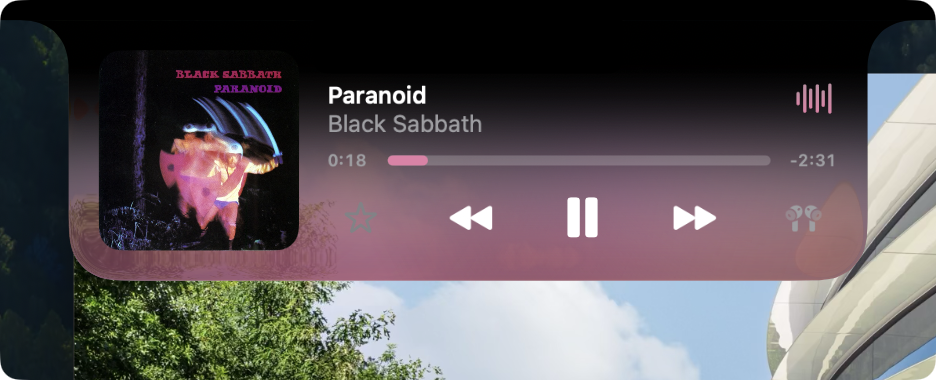
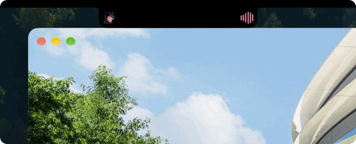
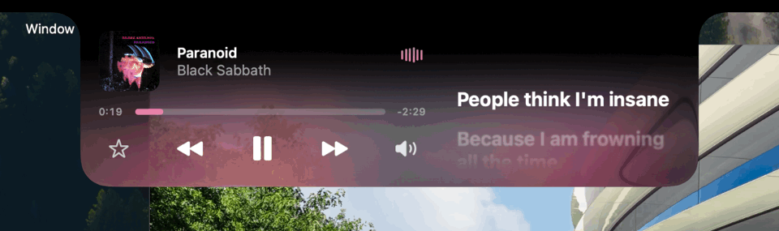
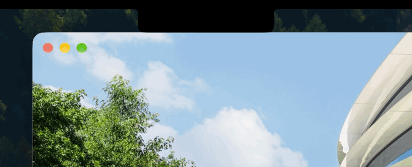

# Glance

*Anything, at a glance.*

 

Glance turns your Mac's notch into a Now Playing display and a tray: whatever
is playing, in almost any app, and the files and copies you want close at hand,
right there on the notch. It's built to look and feel like part of macOS.

Glance works mostly offline. Only a few things need the internet: lyrics,
animated covers, songwriter credits, link previews in the tray, and a daily
check for updates.

 

## Features

### Now Playing

Any app that tells macOS what it's playing shows up here
(the same apps Control Center lists under Now Playing), and you can turn each
one on or off in Settings. Hover over the notch or click it to reveal the
controls, or press ⇧⌘1 in any app to open it.

 
Showcase of the notch opening and closing.

 

### Two layouts

Glance has two layouts: one inspired by the iPhone's Dynamic Island, and one
shaped to better suit the MacBook's proportions.

 
Showcase of the player with the cover on the side.

 

### Live Activities

While something plays, the closed notch shows the cover on one side and a
waveform of the audio on the other. When the song changes, you see it at a
glance.

 
Showcase of Live Activities on the closed notch.

 

### Timed lyrics

Click the waveform and the notch widens to show the words in time with the song,
whenever LRCLIB has timed lyrics for it.

 
Showcase of the lyrics in the open notch.

 

### Tray

Drag files onto the notch to keep them close, and find what you copied and your
screenshots, ready to paste again or AirDrop. Press ⇧⌘2 in any app to open it.

 
Showcase of a photo dropped into the tray.

 

### And more

Animated album covers, a notch or a Dynamic Island on displays without one,
customizable controls and backgrounds, and more. See
[Features](https://github.com/imgaty/Glance/blob/main/docs/FEATURES.md) for the
full list.

 

## Documentation

[User Manual](https://github.com/imgaty/Glance/blob/main/docs/USER-MANUAL.md) |
[Features](https://github.com/imgaty/Glance/blob/main/docs/FEATURES.md) |
[Contributing](https://github.com/imgaty/Glance/blob/main/CONTRIBUTING.md) |
[Changelog](https://github.com/imgaty/Glance/blob/main/CHANGELOG.md)

Download the latest version from the
[releases](https://github.com/imgaty/Glance/releases/latest). The
[User Manual](https://github.com/imgaty/Glance/blob/main/docs/USER-MANUAL.md#installation)
explains how to open it the first time.

Glance uses [Sparkle](https://sparkle-project.org) for updates; its license is
in the
[Third-Party Notices](https://github.com/imgaty/Glance/blob/main/THIRD-PARTY-NOTICES.md).

 

## License

[MIT](LICENSE)
