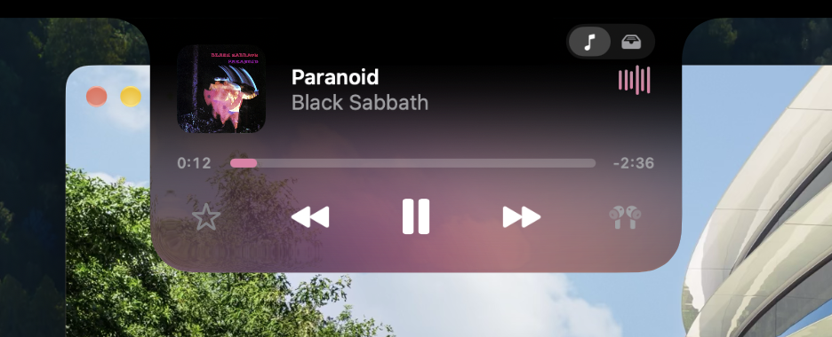
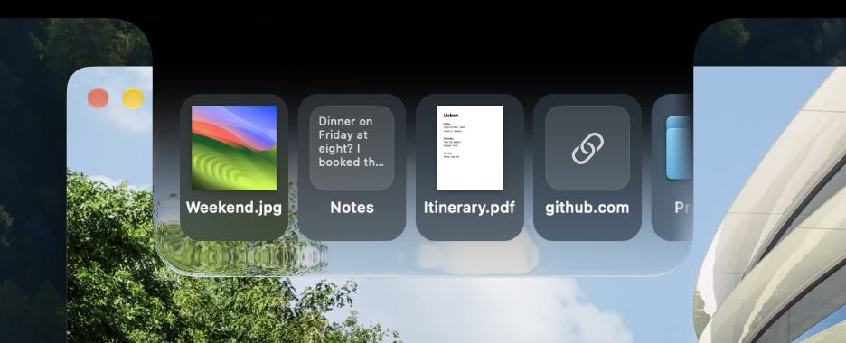

# User Manual

`Created: 11 October 2026` | `Last updated: 24 October 2026`

Installing, using, updating, and removing Glance and all its features.

<br>

## Installation

Glance needs a Mac with Apple silicon and macOS 26 or later.

### From a release

Download `Glance.dmg` from the
[releases](https://github.com/imgaty/Glance/releases/latest), open it, and drag
Glance onto the Applications folder beside it. Then open Glance from
Applications.

### Opening it the first time

Glance is signed but not notarized by Apple, so the first time it opens, macOS
says it couldn't verify it. Click **Done**, then:

1. Open **System Settings > Privacy & Security**.
2. Scroll down to "Glance was blocked to protect your Mac." and click
   **Open Anyway**.
3. Confirm with your password or Touch ID, and click **Open Anyway** once more.

macOS remembers the choice, so updates open without asking. Alternatively, run
this in Terminal:

```sh
xattr -dr com.apple.quarantine /Applications/Glance.app
```

### From source

Building needs Xcode 26 or later. Clone the repository, then build and open
Glance:

```sh
git clone https://github.com/imgaty/Glance.git
```
```sh
cd Glance && ./build.sh --run
```

The app is built into `build/Glance.app`. See [Contributing](../CONTRIBUTING.md)
for more.

### The welcome tour

The first time Glance opens, a short tour shows each feature, sets up the
choices that matter, and asks for the permissions. To see its permissions page
again, use **Settings > General > Permissions > Review…**.

<br>

## Opening and closing

Hover over the notch or click it, depending on
**Settings > Opening > Open with**: `Hover`, `Click`, or `Hover or click`. The
notch closes when the pointer leaves it. The player, the tray and the lyrics
come and go as the Dynamic Island's activities do, fading in out of a blur and
away into one, as the notch opens, closes, or switches between them. With
Reduce Motion on, they only fade.

| Gesture | Operation |
| --- | --- |
| Hover | Opens the notch, after the hover delay |
| Click | Opens the notch; click and hold, if a hold time is set |
| Swipe down with two fingers | Opens the notch |
| Swipe up with two fingers | Closes the notch |
| Swipe left or right with two fingers | Changes songs; on the tray, scrolls it |
| Swipe left or right with three fingers, on the open notch | Switches to the tray, and back to the player (with `Accessibility` allowed) |
| Hold Shift and scroll sideways | Switches to the tray, and back to the player; a mouse's wheel scrolls a tray with more than fits instead |
| Right-click | Shows the menu: Check for Updates…, Settings, and Quit |
| Drag something near the notch and hold it there a moment | Opens the tray, to drop it there |
| ⇧⌘1, from any app | Opens the notch with the player; again, closes it |
| ⇧⌘2, from any app | Opens the notch with the tray; again, closes it |

The notch opens on the player. The tray is to its right: swipe toward it with
three fingers on the open notch, or hold Shift and scroll, and back to return.
Three fingers anywhere else still move between desktops.

Opened with a shortcut, the notch stays open until you press it again, click
elsewhere, or move the pointer onto the notch and away. It takes the keyboard
too, as Spotlight does, until it closes. A click in the tray gives it the
keyboard the same way:

| Key | Operation |
| --- | --- |
| Escape or ⌘W | Closes the notch |
| Space | Plays or pauses; on the tray, shows the selected items in Quick Look |
| Left or right arrow | Goes to the song before or after; on the tray, selects the item before or after it, or with Shift, a run of them |
| Return | On the tray, pastes the selected items where you were typing (with `Accessibility` allowed) |
| ⌘C | On the tray, copies the selected items |
| ⌘A | On the tray, selects everything |
| ⌘Delete | On the tray, removes the selected items |
| ⌘Z | On the tray, brings back what you last removed, for a minute |
| Type a name | On the tray, selects the first item whose name starts with it; Space typed partway is part of the name |

⇧⌘1 and ⇧⌘2 work ahead of every app's own shortcuts, so while Glance runs they
replace Xcode's Welcome to Xcode and Devices and Simulators. To use other
shortcuts, change them in **Settings > Opening**.

<br>

## The player

The open notch shows the cover, the song's name and artist, a progress bar, and
the controls. Drag the progress bar to move through the song. With
**Show app icon on artwork** on, the playing app's icon sits on the cover's
corner; click it to switch to that app.


<br>
<sub>The player, with the cover on top</sub>

### Controls

Beside the playback controls are two buttons of your choice. Choose them in
**Settings > Music > Controls > Customize Controls**.

| Control | Operation |
| --- | --- |
| `Favorite` | Adds the song to favorites (`Music`) |
| `Shuffle` | Turns shuffle on or off (`Music` and `Spotify`) |
| `Repeat` | Repeats all songs, one song, or none (`Music` and `Spotify`) |
| `Sound Output` | Chooses where the sound plays, and the app's volume |
| `Lyrics` | Shows the song's words |
| `None` | Leaves the place empty |

### Sound output and volume

The `Sound Output` button opens a menu of your speakers and headphones. At its
top, a slider sets the playing app's volume without touching any other app's.
For `Music` and `Spotify` it uses their own volume; other apps need the
`Audio from apps` permission.

### Lyrics

Click the waveform to show the song's words beside the player, and click it
again to hide them. The line being sung is large and bright; the next one fades
in below it. Lyrics come from [LRCLIB](https://lrclib.net), and show only when a
record matches the song's title, artist and length.

<br>

## The tray

The tray keeps the files you drop on the notch, what you copy, and your
screenshots, newest first, as Finder shows files: each item's icon, with its
name under it. Copied text shows as a page of its first words, and a link as
its site's icon, with where on the site it goes under the site's name. Open it
with ⇧⌘2, or switch to it from the player. Dragging a file, or anything else
the tray takes, near the notch and holding it there a moment opens it too, ready
for the drop, without reaching the top edge.


<br>
<sub>The tray, with files dropped on it and a note and a link copied</sub>

| Action | Operation |
| --- | --- |
| Drag files onto the notch, onto `Keep in Tray` | Keeps them in the tray until you remove them |
| Drag files onto the notch, onto `AirDrop` | Sends them with AirDrop, without keeping them |
| Click an item | Selects it, as in Finder |
| Command-click an item | Adds it to the selection, or takes it out, to drag, AirDrop or remove several together |
| Shift-click an item | Selects everything from the last item selected to it |
| Double-click an item | Pastes it where you're typing (with `Accessibility` allowed) |
| Drag an item out | Puts it there, with the others selected; files move or copy as they do in Finder |
| Swipe left or right with two fingers, or scroll a mouse's wheel | Scrolls the tray |
| Right-click an item | Open, Open With, Show in Finder, Quick Look, Copy, Paste, Share (AirDrop is there), Keep, and Remove from Tray |
| Hold Option in an item's menu | Turns Paste into Paste and Match Style, for text without its style |
| Choose **Services > Glance Tray** in Finder or any app | Keeps what's selected there in the tray, as a drop does |
| Choose **Share > Glance Tray** in Safari, Photos, Finder or any app | Keeps what's shared in the tray, as a drop does; a picture on a web page too |

Something dragged onto the notch from another app gets two places to go:
`Keep in Tray` and `AirDrop`. To send items already in the tray, right-click
them and choose Share, which has AirDrop. A link shows its site's icon, which
Glance fetches from the site, as Messages does.

Files stay where they are; the tray only points to them, and follows them if
they move. If a file is deleted, it leaves the tray too.

### What you copy

Text, links, pictures and files you copy show up in the tray, and stay for
30 minutes, 8 hours or 7 days, as set in **Settings > Tray**. Passwords, and
anything an app marks as private, are never kept, and neither is what you copy
on another device. Copying something that's already there moves it to the
front. What you copy while the pointer is on the tray waits until it leaves, so
nothing moves under the pointer.

To keep a copy until you remove it, right-click it and choose Keep; a pin shows
before its name. Choose Don't Keep to let it go again, after the usual time from
then. To never keep what you copy in an app, add the app under
**Settings > Tray > Never keep copies from**.

### Screenshots

Each screenshot joins the tray as soon as it's saved, wherever you save them,
and stays as long as copies do, or until you remove it if you choose Keep. Turn
this off with **Settings > Tray > Keep screenshots**.

### Seeing everything

The tray grows wider with what's in it, from three items' width up to six
items, with the next one peeking in at its edge. Past that, swipe left or right
with two fingers, or scroll a mouse's wheel, to see the rest.

<br>

## Live Activities

While something plays, the closed notch shows the cover on its left and a
waveform on its right. When something new starts playing, its name and artist
appear beside the notch for a moment. Everything here comes and goes as on the
iPhone's Dynamic Island: the notch widens and folds, and what it shows rides
in and out with its ends, fading in out of a blur and away into one. A new
song's cover comes in the same way as the last one goes. With Reduce Motion on,
the notch widens without bouncing, and what it shows fades without a blur. In
full screen, where it's all black around the notch, a thin line in the
activity's color outlines it while it's collapsed, as around the Dynamic Island.

What each live activity shows sits right against the camera, closed or opened,
with nothing under it. The notch is only as wide as the wider side needs, the
same on both sides, and widens or narrows as a timer or the stopwatch gains or
loses a digit.

Turn these off with **Cover and waveform** and **Announce new audio** in
**Settings > Music**.

### What the Mac announces

As the iPhone's Dynamic Island does, the closed notch widens for a few seconds,
as long as the iPhone shows AirPods arriving, to show what just happened, then
goes back to what it showed. What it shows fades in and out through a blur,
sliding under the notch as it folds:

| Moment | What shows |
| --- | --- |
| Plugging in a MacBook | `Charging`, and the battery's level beside a battery, yellow in Low Power Mode |
| A MacBook's battery at 20%, and again at 10% | `Low Battery`, and its level, in red |
| AirPods, Beats or other headphones connecting | The AirPods or Beats themselves in 3D, from Apple's and Beats' own models, turning as the iPhone turns AirPods (AirPods Max as macOS pictures them; AirPods 1 and 2, older Beats and other headphones, their symbol), and their battery as a ring: the lower earbud's, with its level beside it for those not in 3D |
| A Bluetooth keyboard, mouse, trackpad or game controller connecting | Its symbol turning in, and, when it tells the Mac, its battery's level beside a ring |
| The sound going to an AirPlay speaker or TV | AirPlay's symbol, and the speaker's name |

Batteries show green, or red at 20% and below. VoiceOver reads each one out.

What's connected when Glance starts, or reconnects as the Mac wakes, isn't
announced. Turn each of these off in **Settings > Live Activities**.

### Timer and stopwatch

The timer and the stopwatch are Clock's: start them in the Clock app, in Control
Center or with Siri, and the notch shows them. **Open Clock** in
**Settings > Live Activities** opens Clock.

A timer counts down beside the camera as the iPhone's Timer does, a ring
emptying beside the time left: in minutes from ten minutes up, then in minutes
and seconds, with a pause symbol before the time while it's paused. It goes by
the label it was given in Clock, if any. The stopwatch counts up beside its
symbol, whose hand goes round once a minute, its hundredths small after the
seconds, with the pause symbol while it's stopped.

While something plays, the music keeps the notch and the timer moves out of it
into a round bubble of its own off the notch's right end, showing its ring, as
the iPhone shows several activities at once. The stopwatch goes off the left
end, or the right if there's no timer. While a new song's name shows, the
bubbles run back into the notch, and come out again after it. With Reduce Motion
on, they fade in and out where they rest.

Hover over or click the notch while a timer has it, or click the timer's bubble,
and it opens to the timer, as tall as the iPhone's: pause or resume it, or
cancel it, with the round buttons left of the camera. The time is right of it,
and its name under the camera. Opened, the stopwatch shows its time alone, to
the hundredth: stop it or start a new lap with its buttons, or, once it's
stopped, start it again or reset it. Bubbles open only with a click.

Its buttons work as Clock's own do, and what they do shows at once: Glance opens
Clock hidden, shows it for a moment behind every other window, and, if it wasn't
open, quits it half a minute after the last press. Without `Accessibility`,
they're dimmed, and pressing one asks for it (see [Permissions](#permissions)).
The notch's right-click menu has the same buttons.

When a timer rings, the notch grows as tall as the iPhone's Timer to say so,
beside macOS's own alert and chime. Click **Repeat** to start the same length
again, or **✕** to stop it; both answer macOS's alert too, which stops its
chime, and leave the notch closed. Opening the notch stops it too. Stopped or
repeated in macOS's alert, it goes from the notch as well.

While a timer shows, Glance takes macOS's own timer out of the menu bar, with
`Accessibility` allowed; macOS keeps that choice. To have it back in the menu
bar, turn off **Hide in menu bar** in **Settings > Live Activities**, then click
**Menu Bar Settings…** there and choose `Show When Active` for Timer. Turn off
**Timers** or **Stopwatch** there to leave them out of the notch.

VoiceOver reads the timer as its name and the time left in words, and whether
it's paused, and the stopwatch as its time. It reads each, in the notch or a
bubble, as a button, which opens it, and the rung timer's **Repeat** and **✕**
as Repeat and Stop.

Glance doesn't show Clock's alarms: macOS keeps them where other apps can't
read them.

<br>

## Menu bar

Glance's icon in the menu bar opens a menu:

| Item | Operation |
| --- | --- |
| `Glance` switch | Turns the notch off on every display, until it's turned back on |
| `Check for Updates…` | Looks for a new version now |
| `Rebuild` | Builds Glance again from its source and relaunches it (builds made from source only) |
| `Glance Settings…` | Opens Settings |
| `Quit Glance` | Quits Glance |

<br>

## Settings

### General

| Setting | Operation |
| --- | --- |
| `Open at login` | Starts Glance when you log in |
| `Permissions` | Shows the permissions page of the welcome tour |
| `Check for Updates…` | Looks for a new version now |
| `Update automatically` | Looks for, downloads and installs new versions on its own |

### Appearance

| Setting | Operation |
| --- | --- |
| `Use the same appearance on all displays` | One look for every display, or a separate one for each (with more than one display) |
| `Match system Liquid Glass` | Follows the Liquid Glass style chosen in System Settings > Appearance |
| `Liquid Glass` | From clear glass to black |
| `Blur` | How much the glass blurs what's behind it |
| `Use artwork colors` | Tints the notch with the cover's colors; off, with your Mac's accent color |
| `Background` | `Replace glass`, `Fullscreen`, `Spotlight`, or `None` behind the player |

With **Reduce transparency** or **Increase contrast** on in **System Settings >
Accessibility > Display**, the notch is opaque, and with **Increase contrast**
the player sits on plain black. With **Reduce motion** on, covers and their
colors hold still, and long titles end in an ellipsis instead of scrolling.

### Music

| Setting | Operation |
| --- | --- |
| `Layout` | `Cover on top` or `Cover on the side` |
| `Controls` | The two buttons beside the playback controls |
| `Lyrics` | Whether clicking the waveform shows the words |
| `Tint progress bar` | Colors the progress bar with the accent color |
| `Animated art` | Plays an album's animated cover, when it has one |
| `Show app icon on artwork` | Shows the playing app's icon on the cover (off at first) |
| `Cover and waveform` | What's playing beside the camera while the notch is closed |
| `Announce new audio` | Briefly shows what starts playing |
| `Apps` | Which apps' audio Glance shows |
| `Show new apps` | Whether apps that start playing are added turned on |

### Tray

| Setting | Operation |
| --- | --- |
| `Tray` | Turns the tray on or off, with its shortcut and its gestures |
| `Keep what you copy` | Keeps what you copy in the tray |
| `Keep screenshots` | Adds each screenshot to the tray |
| `Keep copies and screenshots for` | `30 Minutes`, `8 Hours`, or `7 Days` |
| `Never keep copies from` | Apps whose copies the tray never keeps; add them with `Add App…` |
| `Add from the Share menu` | Shows only while Glance Tray is off in the Share menu, with the way to turn it on |
| `Clear tray` | Removes everything in the tray; files stay where they are |

### Live Activities

| Setting | Operation |
| --- | --- |
| `Music` | **Music Settings** goes to the cover and waveform, and new songs, in **Settings > Music** |
| `Charging` | Shows the battery's level when you plug in (MacBooks only) |
| `Low battery` | Warns at 20% and again at 10% (MacBooks only) |
| `Devices` | Shows headphones, keyboards, mice, trackpads and game controllers as they connect, and sound going to AirPlay |
| `Clock` | **Open Clock** opens the Clock app, where timers and the stopwatch start |
| `Timers` | Shows Clock's timers counting down beside the camera, and says when one rings |
| `Stopwatch` | Shows Clock's stopwatch counting up beside the camera |
| `Hide in menu bar` | Takes macOS's own timer out of the menu bar while the notch shows it, with `Accessibility` allowed |
| `Menu bar timer` | **Menu Bar Settings…** opens **System Settings > Menu Bar**, to bring macOS's own timer back |

### Opening

| Setting | Operation |
| --- | --- |
| `Open with` | `Hover`, `Click`, or `Hover or click` |
| `Hover delay` | How long the pointer rests on the notch before it opens |
| `Click and hold` | How long a click is held before it opens |
| `Haptic feedback` | A light tap on the trackpad when the notch opens (off at first) |
| `Open and close` | Two-finger swipes down and up |
| `Change songs` | Two-finger swipes left and right |
| `Switch to the tray` | Three-finger swipes on the open notch, and scrolling sideways with Shift held |
| `Reverse direction` | Swiping and scrolling the other way to reach the tray |
| `Open the player` | The keyboard shortcut, ⇧⌘1 at first; click it and type another, or Control-click it to restore ⇧⌘1 |
| `Open the tray` | The tray's shortcut, ⇧⌘2 at first, changed the same way |

### Displays

| Setting | Operation |
| --- | --- |
| `Show on displays without a notch` | Draws one on external displays and Macs without a notch |
| `Style` | `Notch` or `Dynamic Island`, for displays without a notch |
| `Hide in full screen` | Hides the notch with the menu bar in full-screen apps |

<br>

## Permissions

macOS asks for each of these the first time Glance needs it. Review them in
**Settings > General > Permissions**, or in
**System Settings > Privacy & Security**.

| Permission | Why |
| --- | --- |
| `Screen & System Audio Recording` (audio only) | The waveform, and the volume slider for apps other than `Music` and `Spotify`. Nothing is recorded or leaves your Mac |
| `Automation` for `Music` | The shuffle, repeat, favorite and volume controls |
| `Automation` for `Spotify` | The shuffle, repeat and volume controls |
| `Accessibility` | Repeating one song in `Spotify`, through its own Repeat command; pasting from the tray; three-finger swipes on the notch; pressing Clock's buttons for its timer and stopwatch, and answering its alert when a timer rings; and taking macOS's own timer out of the menu bar while the notch shows it |
| `Paste from Other Apps` (only if macOS asks) | Keeping what you copy in the tray |

<br>

## Updates

Glance looks for a new version once a day. With **Update automatically** on, it
downloads and installs it the next time Glance quits; otherwise it asks first.
To check now, use **Check for Updates…** in the menu bar menu or in
**Settings > General**.

Updates come from Glance's
[releases](https://github.com/imgaty/Glance/releases), and are installed only if
their signature matches the one built into Glance.

<br>

## Troubleshooting

1. **macOS says Glance can't be opened.** It isn't notarized; see
   [Opening it the first time](#opening-it-the-first-time).

2. **The waveform doesn't move.** Glance needs the `Audio from apps` permission.
   Allow it in **Settings > General > Permissions**, or turn on Glance under
   **System Settings > Privacy & Security > Screen & System Audio Recording**,
   in **System Audio Recording Only**.

3. **Shuffle or repeat does nothing in Music or Spotify.** Glance needs to
   control that app: turn it on under
   **System Settings > Privacy & Security > Automation > Glance**.

4. **Repeat one doesn't work in Spotify.** Turn on Glance under
   **System Settings > Privacy & Security > Accessibility**.

5. **A song has no lyrics.** LRCLIB has no timed lyrics that match it. Glance
   shows none rather than another song's.

6. **Nothing shows for an app.** It may be turned off in
   **Settings > Music > Apps**.

7. **There's no notch on an external display.** Turn on
   **Settings > Displays > Show on displays without a notch**.

8. **What I copy doesn't show up in the tray.** Turn on
   **Settings > Tray > Keep what you copy**. If macOS asked about pasting from
   other apps, allow Glance under
   **System Settings > Privacy & Security > Paste from Other Apps**.

9. **Double-clicking an item copies it but doesn't paste it.** Turn on Glance
   under **System Settings > Privacy & Security > Accessibility**.

10. **Glance Tray isn't in the Services menu.** Turn it on under
    **System Settings > Keyboard > Keyboard Shortcuts > Services**. The
    Services menu offers it for selected text and files; for a picture on a web
    page, use the Share menu.

11. **Glance Tray isn't in the Share menu.** macOS adds a new app's
    Share extension turned off. Turn it on under
    **System Settings > General > Login Items & Extensions**, in Sharing, or
    from **Settings > Tray**, which shows the way while it's off.

<br>

## Uninstalling

If Glance opens at login, turn that off first in **Settings > General**. Then
quit Glance from its menu bar menu, and drag it from Applications to the Trash.

Its settings and the tray stay behind in case you reinstall it. To remove
them, and its permissions, run:

```sh
defaults delete dev.vibe.Glance
```
```sh
rm -rf ~/Library/Application\ Support/dev.vibe.Glance
```
```sh
rm -rf ~/Library/Caches/dev.vibe.Glance
```
```sh
tccutil reset All dev.vibe.Glance
```
