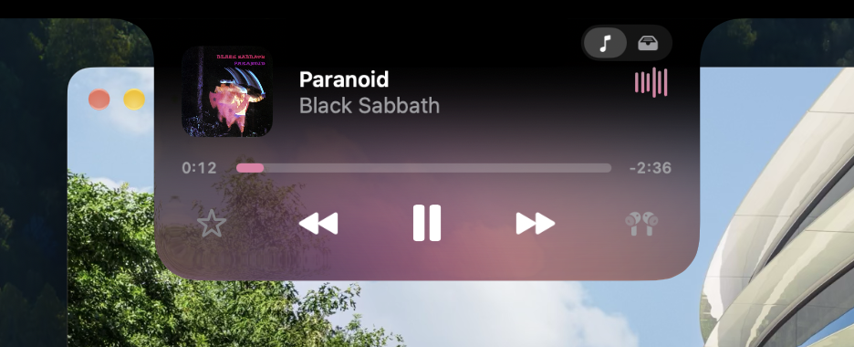
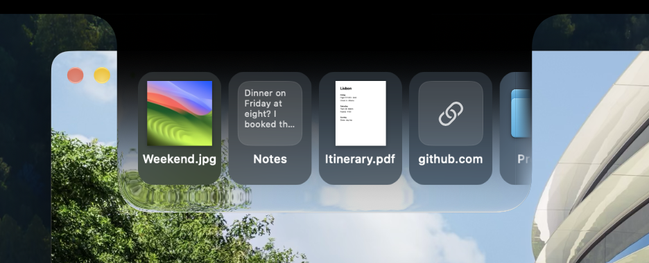

# User Manual

`Created: 11 October 2026` | `Last updated: 6 November 2026`

Installing, using, updating, and removing Glance and all its features.

<br>

## Installation

Glance needs a Mac with Apple silicon and macOS 26 or later.

### From a release

Download `Glance.dmg` from the
[releases](https://github.com/imgaty/Glance/releases/latest), open it, and drag
Glance onto the Applications folder beside it. Then open Glance from
Applications.

### Opening it the first time

Glance is signed but not notarized by Apple, so the first time it opens, macOS
says it couldn't verify it. Click **Done**, then:

1. Open **System Settings > Privacy & Security**.
2. Scroll down to "Glance was blocked to protect your Mac." and click
   **Open Anyway**.
3. Confirm with your password or Touch ID, and click **Open Anyway** once more.

macOS remembers the choice, so updates open without asking. Alternatively, run
this in Terminal:

```sh
xattr -dr com.apple.quarantine /Applications/Glance.app
```

### From source

Building needs Xcode 26 or later. Clone the repository, then build and open
Glance:

```sh
git clone https://github.com/imgaty/Glance.git
```
```sh
cd Glance && ./build.sh --run
```

The app is built into `build/Glance.app`. See [Contributing](../CONTRIBUTING.md)
for more.

### The welcome tour

The first time Glance opens, a short tour shows each feature, sets up the
choices that matter, and asks for the permissions: **Request…** beside each one
brings up macOS's own question. To see its permissions page again, use
**Settings > General > Permissions > Review…**.

<br>

## Language

Glance speaks the language macOS shows it in, so there's nothing to set in Glance,
and it comes in every language macOS does. To use another one for Glance alone,
choose it in **System Settings > General > Language & Region > Applications**, then
open Glance again. The same words macOS uses, such as those for its own settings,
are taken from macOS. Names like AirDrop and Spotify stay as they are, and so does
what a song or a file calls itself.

In Arabic and Hebrew, Glance reads right to left: the notch, Settings, the welcome
tour and the tray's row mirror, and so do the arrows, swipes and scrolling that move
through them. Playback doesn't: the progress bar still fills from the left, previous
stays on the left and next on the right, and fingers going left still bring the next
song. Times and percentages use the digits of your language and region.

## Opening and closing

Hover over the notch or click it, depending on
**Settings > Opening > Open with**: `Hover`, `Click`, or `Hover or click`. The
notch closes when the pointer leaves it. The player, the tray and the lyrics
come and go as the Dynamic Island's activities do, fading in out of a blur and
away into one, as the notch opens, closes, or switches between them. With
Reduce Motion on, they only fade, and nothing bounces: the notch, the bubbles and
the cover settle straight where they're going, the star glows without swelling,
the skip arrows stay where they are, and the welcome tour's pages fade rather
than slide.

| Gesture | Operation |
| --- | --- |
| Hover | Opens the notch, after the hover delay; with two activities showing, opens the notch or the bubble once the pointer stops on it |
| Click | Opens the notch; click and hold, if a hold time is set |
| Swipe down with two fingers | Opens the notch |
| Swipe up with two fingers | Closes the notch; on the closed notch, swipes its live activity away (see [Live Activities](#live-activities)) |
| Swipe left or right with two fingers | Changes songs; on the tray, scrolls it |
| Swipe left or right with three fingers, on the open notch | Stretches the notch and what's in it with your fingers and switches to the tray, and back to the player, springing into place as you let go (with `Accessibility` allowed) |
| Hold Shift and scroll sideways | Switches to the tray, and back to the player; a mouse's wheel scrolls a tray with more than fits instead, and, scrolled on past the row's end, goes back to the player |
| Right-click | Shows the menu: Check for Updates…, Settings, and Quit |
| Drag something near the notch and hold it there a moment | Opens the tray, to drop it there |
| ⌥⇧1, from any app | Opens the notch with the player; again, closes it |
| ⌥⇧2, from any app | Opens the notch with the tray; again, closes it |

The notch opens on the player. The tray is to its right: swipe toward it with
three fingers on the open notch, or hold Shift and scroll, and back to return.
Three fingers anywhere else still move between desktops.

Pulled down with two fingers, the open notch stretches, and settles back as you
let go. The player, the tray and the lyrics stay where they are.

Opened with a shortcut, the notch stays open until you press it again, click
elsewhere, or move the pointer onto the notch and away. It takes the keyboard
too, as Spotlight does, until it closes. A click in the tray gives it the
keyboard the same way:

| Key | Operation |
| --- | --- |
| Escape or ⌘W | Closes the notch |
| Tab or Shift-Tab | On the player, goes from control to control, with a ring around the one it's on, and through the lyrics while they show; on a live activity's own view, from button to button |
| Space | Presses the control with the ring; otherwise plays or pauses; on the tray, shows the selected items in Quick Look |
| Left or right arrow | Goes to the song before or after, or with the ring on the progress bar, ten seconds back or ahead; on the tray, selects the item before or after it, or with Shift, a run of them |
| Up or down arrow | With a timer, the stopwatch, AirDrop or AirPlay showing, goes from the player to its own view, the ring on its first button, and back; with the ring on the lyrics, goes from line to line, and Space or Return plays from there; with the ring on `Sound Output`, turns the playing app's sound up or down |
| Return | Presses the control with the ring; on the tray, pastes the selected items where you were typing (with `Accessibility` allowed) |
| ⌘C | On the tray, copies the selected items |
| ⌘A | On the tray, selects everything |
| ⌘Delete | On the tray, removes the selected items |
| ⌘Z | On the tray, brings back what you last removed, for a minute |
| Type a name | On the tray, selects the first item whose name starts with it; Space typed partway is part of the name |

⌥⇧1 and ⌥⇧2 work ahead of every app's own shortcuts. To use other shortcuts,
change them in **Settings > Opening**.

### With a finger

On a MacBook Pro with Touch, or an iPad's display over Sidecar, the notch also
works with a finger:

| Gesture | Operation |
| --- | --- |
| Tap | Opens the notch, whatever `Open with` is set to; on a bubble, opens its activity; on a ringing timer, presses its button |
| Drag down | Opens the notch |
| Drag up | Closes the notch; on the closed notch, swipes its live activity away |
| Drag left or right | Changes songs; on the tray, scrolls it, gliding on as you let go |
| Drag left or right with two fingers, on the open notch | Switches to the tray, and back to the player |
| Touch and hold | Shows the menu; on an item in the tray, the item's menu |

A finger brings no pointer to leave the notch with, so once it opens the notch,
the notch stays open until you swipe it up, tap just outside it, switch to
another app, or move the pointer onto it and away. Dragging follows the same
settings in **Settings > Opening** as swiping on the trackpad. Three fingers on
the display are macOS's, as they are on the trackpad.

<br>

## The player

The open notch shows the cover, the song's name and artist, a progress bar, and
the controls. Drag the progress bar to move through the song. With
**Show app icon on cover** on, the playing app's icon sits on the cover's
corner.

The cover lifts gently under the pointer, with a soft shadow, squashes as it's
pressed, and springs back as it's let go.
Click the cover, or the app's icon, to go where the music plays from: the tab
playing it in Safari, Chrome, Brave, Edge or Vivaldi, the playlist or album
Spotify plays it from, or the song in the playlist Music plays it from. Other
browsers switch to the tab with `Accessibility` allowed, in the windows on the
current desktop. Otherwise, it switches to the app.

Behind the player, the cover's colors flow slowly through one another in long
ribbons and pulse on the music's beat, as you hear it: on AirPods and other
wireless headphones, which play a moment late, the pulse and the waveform wait
for the sound. The beat needs the `Audio from apps` permission. With Reduce
Motion on, the colors hold still.


<br>
<sub>The player, with the cover on top</sub>

### Controls

Beside the playback controls are two buttons of your choice. Choose them in
**Settings > Player > Controls > Customize Controls…**. From the keyboard, Tab
goes between the two buttons and the controls under them, Space selects a button
or puts a control in the selected one, and Delete takes a control out of a
button.

| Control | Operation |
| --- | --- |
| `Favorite` | Adds the song to favorites (`Music`) |
| `Shuffle` | Turns shuffle on or off (`Music` and `Spotify`) |
| `Repeat` | Repeats all songs, one song, or none (`Music` and `Spotify`) |
| `Sound Output` | Chooses where the sound plays, and the app's volume |
| `Lyrics` | Shows the song's words |
| `None` | Leaves the place empty |

While Spotify's DJ chooses the music, its symbol takes the left button's place,
as it takes shuffle's in Spotify, moving for as long as the music plays. Click
it for different picks: Glance presses Spotify's own button for them, through
`Accessibility`. Spotify shows its buttons to other apps only when it's started
with a switch for it, so the first click in a Spotify opened without it starts
Spotify again with it, which stops the music for a few seconds, and then presses
the button. Spotify shows that button only while the DJ plays, so with the DJ
paused, it's played first. Glance tells the DJ from other music by that same
button, round and blue beside `Lyrics` in Spotify's bar; before Spotify has been
started with the switch, by hearing the DJ talk. Shuffle and repeat show dimmed with the DJ or a podcast,
because Spotify doesn't offer them then.

While the DJ talks, the cover becomes its green ring on blue, following the same sound
as the waveform, the colors behind the player turn blue, and the times show `--:--`.

To keep the left button as it is while the DJ plays, turn off `Spotify DJ` in
Customize Controls.

### Sound output and volume

The `Sound Output` button opens a menu laid out like the Mac's Sound menu. At
its top, a slider sets the playing app's volume without touching any other
app's. For `Music` and `Spotify` it uses their own volume; other apps need the
`Audio from apps` permission. Below it, under **Output**, each speaker and pair
of headphones is in a circle, the one playing filled in your accent color.
AirPods show each earbud's battery and the case's, and other headphones their
one battery. Click one to play there. **Sound Settings…** opens
**System Settings > Sound**.

### Lyrics

Click the waveform to show the song's words beside the player, and click it
again to hide them. The line being sung is large and bright; the next one fades
in below it. While the song is paused they dim, as the cover and the colors
behind the player do. Lyrics come from [LRCLIB](https://lrclib.net), found as
each song starts so they're ready when you ask for them, and show only when a
record matches the song's title, artist and length.
With Reduce Motion on, each line fades in where it rests rather than gliding
up, and the dots in a pause in the singing hold still.

<br>

## The tray

The tray keeps the files you drop on the notch, what you copy, and your
screenshots and screen recordings, newest first, as Finder shows files: each
item's icon, with its name under it. Copied text shows as a page of its first
words, and a link as its site's icon, with where on the site it goes under the
site's name. Open it with ⌥⇧2, or switch to it from the player. Dragging a file,
or anything else the tray takes, near the notch and holding it there a moment
opens it too, ready for the drop, without reaching the top edge.


<br>
<sub>The tray, with files dropped on it and a note and a link copied</sub>

| Action | Operation |
| --- | --- |
| Drag files onto the notch, onto `Keep in Tray` | Keeps them in the tray until you remove them |
| Drag files onto the notch, onto `AirDrop` | Sends them with AirDrop, without keeping them |
| Click an item | Selects it, as in Finder |
| Command-click an item | Adds it to the selection, or takes it out, to drag, AirDrop or remove several together |
| Shift-click an item | Selects everything from the last item selected to it |
| Double-click an item | Pastes it where you're typing (with `Accessibility` allowed) |
| Drag an item out | Puts it there, with the others selected; files move or copy as they do in Finder |
| Swipe left or right with two fingers, or scroll a mouse's wheel | Scrolls the tray |
| Right-click an item | Open, Open With, Show in Finder, Quick Look, Copy, Paste, Share (AirDrop is there), Keep, and Remove from Tray |
| Hold Option in an item's menu | Turns Paste into Paste and Match Style, for text without its style |
| Choose **Services > Send to Glance Tray** in Finder or any app | Keeps what's selected there in the tray, as a drop does |
| Choose **Share > Glance Tray** in Safari, Photos, Finder or any app | Keeps what's shared in the tray, as a drop does; a picture on a web page too |

Something dragged onto the notch from another app gets two places to go:
`Keep in Tray` and `AirDrop`. To send items already in the tray, right-click
them and choose Share, which has AirDrop. A link shows its site's icon, which
Glance fetches from the site, as Messages does.

Files stay where they are; the tray only points to them, and follows them if
they move. If a file is deleted, it leaves the tray too.

### What you copy

Text, links, pictures and files you copy show up in the tray, and stay for
30 minutes, 8 hours or 7 days, as set in **Settings > Tray**. Passwords, and
anything an app marks as private, are never kept, and neither is what you copy
on another device. Copying something that's already there moves it to the
front. What you copy while the pointer is on the tray waits until it leaves, so
nothing moves under the pointer.

To keep a copy until you remove it, right-click it and choose Keep; a pin shows
before its name. Choose Don't Keep to let it go again, after the usual time from
then. To never keep what you copy in an app, add the app under
**Settings > Tray > Never keep copies from**.

### Screenshots and screen recordings

Each screenshot and screen recording joins the tray as soon as it's saved,
wherever you save them, and stays as long as copies do, or until you remove it
if you choose Keep. Turn this off with
**Settings > Tray > Keep screenshots and screen recordings**.

### Seeing everything

The tray grows wider with what's in it, from three items' width up to six
items, with the next one peeking in at its edge. Past that, swipe left or right
with two fingers, or scroll a mouse's wheel, to see the rest.

<br>

## Live Activities

While something plays, the closed notch shows the cover on its left and a
waveform on its right, filled with the same colors that flow behind the player,
as on the iPhone. When something new starts playing, its name and artist appear
beside the notch for a moment. Everything here comes and goes as on the iPhone's
Dynamic Island: the notch widens and folds, and what it shows rides in and out
with its ends, fading in out of a blur and away into one. A new song's cover
comes in the same way as the last one goes. With Reduce Motion on, the notch
widens without bouncing, and what it shows fades without a blur.

Closed or opened, the notch is only as wide as the wider side of a live
activity needs, the same on both sides, with nothing under the camera. Each
side sits at its own end, as far in from it as from the top and bottom, and on
the taller views, both ends alike. Any room to spare is beside the camera. The
notch widens or narrows as a timer or the stopwatch gains or loses a digit.

Swipe up with two fingers on the closed notch to swipe away what it shows, as
on the iPhone: an announcement folds away, a timer that's ringing stops, and a
live activity stays away until it changes. Music comes back with the next song
or when it plays again, a timer or the stopwatch when it's started, paused or
ended, AirDrop with the next file, and AirPlay with the next speaker. Opened to
a timer, the stopwatch, AirDrop or AirPlay, swiping up closes the notch and
swipes that away too.

Turn these off with `Cover and waveform` and `Announce new audio` in
**Settings > Live Activities**.

### What the Mac announces

As the iPhone's Dynamic Island does, the closed notch widens for a few seconds,
as long as the iPhone shows AirPods arriving, to show what just happened, then
goes back to what it showed. What it shows fades in and out through a blur,
sliding under the notch as it folds:

| Moment | What shows |
| --- | --- |
| Plugging in a MacBook | `Charging`, and the battery's level beside a battery, yellow in Low Power Mode |
| A MacBook's battery at 20%, again at 10%, and when macOS warns that it's low | The notch grows taller: its level, as `10% Battery`, and the battery in a capsule, a ripple running out of its level every two seconds. Click the capsule to turn on Low Power Mode: it turns yellow, the ripple stops, and the notch says `Low Power Mode enabled`. Click it again to turn it off |
| AirPods or Beats connecting | The AirPods or Beats themselves in 3D, from Apple's and Beats' own models, turning, and their battery as a ring: the lower earbud's |
| A device's battery at 20%, and again at 10% | The device as it shows connecting, its ring red, with its level in numbers inside |
| The charging case's battery at 20%, and again at 10% | The case on its own, closed and turning in 3D from the front, from Apple's and Beats' own models, its ring red, with its level in numbers inside. It's the only time the case shows, and it doesn't count towards the earbuds' ring |
| A call coming in | The notch grows as tall as the Alarm: the caller and what the call is over, with a red button to decline and a green one to accept, in place of macOS's popup. FaceTime and phone callers show their initial in a purple to teal circle; other apps' show no picture. Swiped up, a gray handset stays beside the camera while it rings, with the caller's initial for FaceTime and phone calls |
| On a call | A green phone and the call's time beside the camera, and on the other side a waveform of both voices, the other person's green on the left and yours orange on the right, each bar yellow in its middle. Click it and the notch opens. For FaceTime and phone calls it's laid out as the player: the caller's photo from Contacts in the top corner, or their initial in a circle when they have none, and beside it their name, with the call's time on the circle's bottom edge; under them, buttons for the sound output, video, which is off, muting your microphone, going to the call, and a red one to end it. For calls in other apps it's one row, as tall as the Alarm: the caller's name, a button for the sound output and, where Glance can press the app's own, a red one to end it. Click the caller to go to the call. If you mute your microphone from the notch, it's unmuted when the call ends. It comes first for as long as the call lasts: with music or anything else going on, the call keeps its phone and time beside the camera as they are, and the other takes the notch's right side's place in a round bubble off its end, music by its cover, dimmed while paused |

Nothing else is announced: not other makers' headphones and speakers, nor
keyboards, mice, trackpads or game controllers.

Glance knows of a FaceTime or phone call from macOS's own popup for it, and
reads the caller, the time and where its buttons are from that popup's picture,
so it needs `Screen & System Audio Recording`, which macOS asks for during your
first call, and `Accessibility`. Only that popup is ever read, only during a
call, and nothing is kept. Once the notch can offer the same, macOS's popup
moves out of sight, and with it every other notification until the call's over.
Without those permissions, or if the popup can't be read, the popup stays and
the notch shows the call without the caller or its buttons. The buttons click
macOS's own, so the popup shows and the pointer moves for an instant when you
press one.

Apps that tell macOS nothing, such as Zoom, Discord, WhatsApp, Microsoft Teams,
Slack, Telegram and Signal, show once the app uses the microphone: not while it
rings, by the app's name rather than the person's, and ended in the app. For
those, your half of the waveform needs `Microphone`, which Glance asks for
during that call and uses only during calls, and the other half needs `Audio
from apps`. Turn all this off with `Calls` in **Settings > Live Activities**.
Batteries show green, or red at 20% and below. VoiceOver reads each one out.
If macOS doesn't change Low Power Mode from the notch,
**System Settings > Battery** opens, where you can. macOS's own banner at the
top of the screen for a device connecting or running low is hidden while the
notch says the same. With `Accessibility` allowed, so is its banner under the
menu bar for AirPods connecting or running low, and AirPods' own notification
that they need charging is taken away.
With `Accessibility` allowed, macOS's own Low Battery notification and banner
are taken away as it shows, since the notch says so.

What's connected when Glance starts, or reconnects as the Mac wakes, isn't
announced. With the pointer on the notch, an announcement stays, and the notch
swells a little around it, opening once it's over. A device extends instead, as
tall as a timer: the device and its ring grow with the notch, and its name and
its level in numbers show. Sliding down on it, or clicking it if **Open with**
allows that, puts it away and opens the notch at once. With the notch open, it
closes to say what happened, and opens again after, if the pointer is still on
it. Turn each of these off in **Settings > Live Activities**.

### Timer and stopwatch

The timer and the stopwatch are Clock's: start them in the Clock app, in Control
Center or with Siri, and the notch shows them. **Open Clock…** in
**Settings > Live Activities** opens Clock.

A timer counts down beside the camera as the iPhone's Timer does, a ring
emptying beside the time left: in minutes from ten minutes up, then in minutes
and seconds, with a pause symbol before the time while it's paused. It goes by
the label it was given in Clock, if any. The stopwatch counts up beside its
symbol, whose hand goes round once a minute, its hundredths small after the
seconds, with the pause symbol while it's stopped.

While something plays, the music keeps the left of the notch, showing its cover,
and the timer moves out into a round bubble of its own off the notch's right end,
showing its ring, as the iPhone shows two activities at once. A third waits its
turn. While a new song's name shows, the bubble runs back into the notch, and
comes out again after it. With Reduce Motion on, it fades in and out where it
rests.

Hover over or click the notch while a timer has it, or click the timer's bubble,
and it opens to the timer, as tall as the iPhone's: pause or resume it, or
cancel it, with the round buttons left of the camera. The time is right of it,
and its name under the camera. Opened, the stopwatch shows its time alone, to
the hundredth: stop it, or start it over from 0:00 with **↻**, and it keeps
running. Once it's stopped, start it again or reset it.

With two activities showing, the pointer passing over them opens neither: the
notch or the bubble opens once the pointer stops on it, a little after the hover
delay. A click opens either if **Open with** includes it.

Its buttons work as Clock's own do, and what they do shows at once: Glance opens
Clock hidden, shows it for a moment behind every other window, and, if it wasn't
open, quits it half a minute after the last press. Without `Accessibility`,
they're dimmed, and pressing one asks for it (see [Permissions](#permissions)).
The notch's right-click menu has the same buttons.

When a timer rings, the notch grows as tall as the iPhone's Timer to say so,
and rings with the timer's sound, as chosen in Clock, in place of macOS's own
alert, which it takes away. Click **Repeat** to start the same length again, or
**✕** to stop it; both leave the notch closed. Opening the notch stops it too.
With no one there, it stops ringing after five minutes.

Without `Accessibility`, macOS's own alert and chime show beside the notch:
**Repeat** and **✕** answer that alert too, which stops its chime, and stopped
or repeated in macOS's alert, the timer goes from the notch as well.

With **Hide in menu bar** on in **Settings > Live Activities**, off at first,
and `Accessibility` allowed, Glance takes macOS's own timer out of the menu bar
while a timer shows. macOS keeps that choice, even after the switch is turned
off. To have it back in the menu bar, click **Menu Bar settings** under the
switch and choose `Show When Active` for Timer. Turn off **Timers** or
**Stopwatch** there to leave them out of the notch.

VoiceOver reads the timer as its name and the time left in words, and whether
it's paused, and the stopwatch as its time. It reads each, in the notch or a
bubble, as a button, which opens it, and the rung timer's **Repeat** and **✕**
as Repeat and Stop.

Glance doesn't show Clock's alarms: macOS keeps them where other apps can't
read them.

### AirDrop

While a file comes in over AirDrop, the notch shows it as the iPhone does, from
when it starts coming until it's in: AirDrop's symbol in blue at its left end,
and a ring at its right, filling as the file comes in. Behind music, it goes in
a bubble of its own, showing the ring. Something waiting to be accepted shows
once you accept it.

Hover over or click the notch while AirDrop has it, or click its bubble, and it
opens to a picture of the file, who it's from, and the ring around a button:
click it to stop the transfer.

A file you send shows the same way, once it's accepted, the ring filling as it
goes out. Opened, it says who it's going to while macOS's AirDrop window is
open, and otherwise the file's name. Turn both off with `AirDrop` in
**Settings > Live Activities**.

### AirPlay

While the sound plays on an AirPlay speaker or TV, the notch shows it as the
iPhone shows Screen Mirroring: AirPlay's symbol in blue at its left end, and
what it plays on at its right, a TV, a HomePod or a speaker. It stays for as
long as the sound plays there. Behind music or a timer, it goes in a bubble of
its own, showing AirPlay's symbol.

Hover over or click the notch while AirPlay has it, or click its bubble, and it
opens to AirPlay, with the speaker's name. Click **Stop AirPlay** to send the
sound back to where it played before, or to the Mac's own speakers. Turn it off
with `Devices` in **Settings > Live Activities**.

<br>

## Menu bar

Glance's icon in the menu bar opens a menu:

| Item | Operation |
| --- | --- |
| `Glance` switch | Turns the notch off on every display, until it's turned back on |
| `Check for Updates…` | Looks for a new version now |
| `Rebuild` | Builds Glance again from its source and relaunches it (builds made from source only) |
| `Glance Settings…` | Opens Settings |
| `Quit Glance` | Quits Glance |

The menu works from the keyboard too: the up and down arrows go from row to
row, the switch among them, **Return** or **Space** chooses the one lit, a
letter goes to the next row starting with it, and **Escape** closes it.

<br>

## Settings

Settings opens on the page you last used. While it's open, the **View** menu has
**Back** (⌘[), **Forward** (⌘]), **Search** (⌘F) and every page, and
**Help > Glance Help** opens this manual.

### General

| Setting | Operation |
| --- | --- |
| `Open at login` | Starts Glance when you log in |
| `Permissions` | Shows the permissions page of the welcome tour |
| `Check for Updates…` | Looks for a new version now |
| `Update automatically` | Looks for, downloads and installs new versions on its own |

### Appearance

| Setting | Operation |
| --- | --- |
| `Use the same appearance on all displays` | One look for every display, or a separate one for each (with more than one display) |
| `Match system Liquid Glass` | Follows the Liquid Glass style chosen in System Settings > Appearance |
| `Liquid Glass` | From clear glass to black |
| `Blur` | How much the glass blurs what's behind it |
| `Use cover colors` | Tints the notch with the cover's colors; off, with your Mac's accent color |
| `Background` | `Replace glass`, `Spotlight`, or `None` behind the player |

With **Reduce transparency** or **Increase contrast** on in **System Settings >
Accessibility > Display**, the notch is opaque, and with **Increase contrast**
the player sits on plain black. With **Reduce motion** on, covers and their
colors hold still, without pulsing on the beat, and long titles end in an
ellipsis instead of scrolling.

### Player

| Setting | Operation |
| --- | --- |
| `Layout` | `Cover on top` or `Cover on the side` |
| `Controls` | The two buttons beside the playback controls |
| `Lyrics` | Whether clicking the waveform shows the words |
| `Tint progress bar` | Colors the progress bar with the accent color |
| `Animated cover` | Plays an album's animated cover, when it has one |
| `Show app icon on cover` | Shows the playing app's icon on the cover (off at first) |
| `Show audio from` | Which apps' audio Glance shows; **Add App…** adds an app, and right-clicking one offers **Remove from List** |
| `Show new apps` | Whether apps that start playing are added turned on |

### Tray

| Setting | Operation |
| --- | --- |
| `Tray` | Turns the tray on or off, with its shortcut and its gestures |
| `Keep what you copy` | Keeps what you copy in the tray |
| `Keep screenshots and screen recordings` | Adds each one to the tray |
| `Keep them for` | `30 Minutes`, `8 Hours`, or `7 Days` |
| `When dragged out` | `Keep in Tray`, or `Remove from Tray` once something takes the item; ⌘Z brings it back for a minute |
| `Never keep copies from` | Apps whose copies the tray never keeps; **Add App…** adds an app, and **Remove** or right-clicking one takes it off |
| `Add from the Share menu` | Shows only while Glance Tray is off in the Share menu, with the way to turn it on |
| `Clear tray` | Removes everything in the tray; files stay where they are |

### Live Activities

The picture of the notch at the top of the page shows what's turned on, made up,
one after another, and turning a switch on shows it at once. With Reduce Motion
on, it stays on what's playing.

| Setting | Operation |
| --- | --- |
| `Cover and waveform` | What's playing beside the camera while the notch is closed |
| `Announce new audio` | Briefly shows what starts playing |
| `Charging` | Shows the battery's level when you plug in (MacBooks only) |
| `Low battery` | Warns at 20% and again at 10% (MacBooks only) |
| `Devices` | Shows AirPods and Beats as they connect, and sound going to AirPlay |
| `AirDrop` | Shows files coming in and going out over AirDrop, as they go |
| `Clock` | **Open Clock…** opens the Clock app, where timers and the stopwatch start |
| `Timers` | Shows Clock's timers counting down beside the camera, and says when one rings |
| `Stopwatch` | Shows Clock's stopwatch counting up beside the camera |
| `Hide in menu bar` | Takes macOS's own timer out of the menu bar while the notch shows it, with `Accessibility` allowed (off at first). macOS keeps it out even after this is off; **Menu Bar settings**, under it, opens **System Settings > Menu Bar** to bring it back |

### Opening

| Setting | Operation |
| --- | --- |
| `Open with` | `Hover`, `Click`, or `Hover or click` |
| `Hover delay` | How long the pointer rests on the notch before it opens |
| `Click and hold` | How long a click is held before it opens |
| `Haptic feedback` | A light tap on the trackpad when the notch opens (off at first) |
| `Open and close` | Two-finger swipes down and up, and dragging down and up on the display |
| `Change songs` | Two-finger swipes left and right, and dragging left and right on the display |
| `Swipe between tools` | Three-finger swipes on the open notch, scrolling sideways with Shift held, and dragging sideways with two fingers on the display. Scrolling goes the way your Mac scrolls |
| `Open the player` | The keyboard shortcut, ⌥⇧1 at first; click it and type another, or Control-click it to restore ⌥⇧1 |
| `Open the tray` | The tray's shortcut, ⌥⇧2 at first, changed the same way |

### Displays

| Setting | Operation |
| --- | --- |
| `Show the notch` | Whether the display shown has a notch (external displays only; the Mac's own always has one) |
| `Hide in full screen` | In full-screen apps, on the display shown, folds the notch back to the camera with nothing beside it, and it still opens from there as usual. On a display with no camera, it hides with the menu bar |
| `Show on external displays` | Draws a notch on external displays too |

With more than one display, choose one at the top of the page. `Show the notch`
and `Hide in full screen` apply to that display.

<br>

## Permissions

macOS asks for each of these the first time Glance needs it. Review them in
**Settings > General > Permissions**, or in
**System Settings > Privacy & Security**.

| Permission | Why |
| --- | --- |
| `Screen & System Audio Recording` (audio only) | The waveform, the colors behind the player pulsing on the beat, and the volume slider for apps other than `Music` and `Spotify`. Nothing is recorded or leaves your Mac |
| `Automation` for `Music` | The shuffle, repeat, favorite and volume controls, and showing the song in its playlist when the cover is clicked |
| `Automation` for `Spotify` | The shuffle, repeat and volume controls, and opening the playlist it plays from when the cover is clicked |
| `Automation` for your browser | Switching to the tab that's playing when the cover is clicked (`Safari`, `Chrome`, `Brave`, `Edge` and `Vivaldi`) |
| `Accessibility` | Repeating one song in `Spotify`, through its own Repeat command; pasting from the tray; three-finger swipes on the notch; pressing Clock's buttons for its timer and stopwatch; taking away macOS's own alert when a timer rings, to ring in its place, and its Low Battery notification; hiding macOS's own banner for AirPods under the menu bar; taking macOS's own timer out of the menu bar while the notch shows it; and switching to the tab that's playing in other browsers |
| `Screen & System Audio Recording` (screen) | Reading macOS's popup for a FaceTime or phone call during one: the caller, the time, its waveform and where its buttons are. macOS also asks to let Glance skip its window picker: only that popup is read |
| `Microphone` | Your half of the waveform on calls in other apps, during those calls |
| `Contacts` | The caller's photo during a FaceTime or phone call, asked for during your first one. Glance looks up only the name or number macOS's popup shows; if two of your contacts have that name, it tells them apart by the picture in the popup. Without it, the caller shows their initial |
| `Paste from Other Apps` (only if macOS asks) | Keeping what you copy in the tray |

<br>

## Updates

Glance looks for a new version once a day. With **Update automatically** on, it
downloads and installs it the next time Glance quits; otherwise it asks first.
To check now, use **Check for Updates…** in the menu bar menu or in
**Settings > General**.

Updates come from Glance's
[releases](https://github.com/imgaty/Glance/releases), and are installed only if
their signature matches the one built into Glance.

<br>

## Troubleshooting

1. **macOS says Glance can't be opened.** It isn't notarized; see
   [Opening it the first time](#opening-it-the-first-time).

2. **The waveform doesn't move.** Glance needs the `Audio from apps` permission.
   Allow it in **Settings > General > Permissions**, or turn on Glance under
   **System Settings > Privacy & Security > Screen & System Audio Recording**,
   in **System Audio Recording Only**.

3. **Shuffle or repeat does nothing in Music or Spotify.** Glance needs to
   control that app: turn it on under
   **System Settings > Privacy & Security > Automation > Glance**.

4. **Repeat one doesn't work in Spotify.** Turn on Glance under
   **System Settings > Privacy & Security > Accessibility**.

5. **A song has no lyrics.** LRCLIB has no timed lyrics that match it. Glance
   shows none rather than another song's. If it says lyrics can't be reached,
   LRCLIB isn't answering: Glance keeps asking, and they show once it does.

6. **Nothing shows for an app.** It may be turned off in
   **Settings > Player > Apps**.

7. **There's no notch on an external display.** Turn on
   **Settings > Displays > Show on external displays**.

8. **What I copy doesn't show up in the tray.** Turn on
   **Settings > Tray > Keep what you copy**. If macOS asked about pasting from
   other apps, allow Glance under
   **System Settings > Privacy & Security > Paste from Other Apps**.

9. **Double-clicking an item copies it but doesn't paste it.** Turn on Glance
   under **System Settings > Privacy & Security > Accessibility**.

10. **Send to Glance Tray isn't in the Services menu.** Turn it on under
    **System Settings > Keyboard > Keyboard Shortcuts > Services**. The
    Services menu offers it for selected text and files; for a picture on a web
    page, use the Share menu.

11. **Glance Tray isn't in the Share menu.** macOS adds a new app's
    Share extension turned off. Turn it on under
    **System Settings > General > Login Items & Extensions**, in Sharing, or
    from **Settings > Tray**, which shows the way while it's off.

<br>

## Uninstalling

If Glance opens at login, turn that off first in **Settings > General**. Then
quit Glance from its menu bar menu, and drag it from Applications to the Trash.

Its settings and the tray stay behind in case you reinstall it. To remove
them, and its permissions, run:

```sh
defaults delete dev.vibe.Glance
```
```sh
rm -rf ~/Library/Application\ Support/dev.vibe.Glance
```
```sh
rm -rf ~/Library/Caches/dev.vibe.Glance
```
```sh
tccutil reset All dev.vibe.Glance
```
